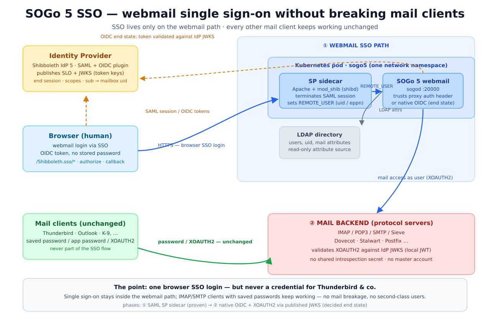

# SOGo 5 SSO — webmail single sign-on without breaking mail clients

> **The idea:** give SOGo 5 webmail proper single sign-on through the
> university Shibboleth identity provider — **without ever disrupting
> Thunderbird, Outlook, K-9 and every other mail client.** SSO is a
> *webmail* concern only; IMAP/SMTP clients with saved passwords simply
> keep working.

## The trap this PoC avoids

In an organisation, the same account logs into webmail and into the mail
client. A naive SSO rollout that puts a SAML gate in front of the whole
stack **breaks every non-browser client**, because the SSO credential from
the browser never reaches IMAP/SMTP. This repository shows and implements
the decomposition that avoids the trap: SSO stays on the webmail path, the
mail servers and all clients that talk to them directly are left alone.

## How it works



One Kubernetes pod, one shared network namespace, two containers. The
diagram shows both login paths — the SSO path (blue) and the untouched
mail-client path (green):

| Login path | Who | How | State |
|---|---|---|---|
| **Webmail (browser)** | humans | Shibboleth SP sidecar in front of SOGo → native OIDC as end state | SP sidecar proven; OIDC decided |
| **Mail clients** | Thunderbird, Outlook, K-9, … | password / app password / XOAUTH2 directly against IMAP/SMTP | unchanged by design |

- **SAML phase (implemented here):** the sidecar terminates the IdP
  session and hands `REMOTE_USER` (`uid`/`eppn`) to SOGo
  (`SOGoTrustProxyAuthentication`). It works with any Shibboleth IdP;
  metadata is mounted at runtime, the shipped manifests use placeholders.
- **OIDC end state (decided):** SOGo speaks OIDC natively
  (`SOGoAuthenticationType = openid`). The webmail token doubles as the
  IMAP/SMTP credential via **XOAUTH2**, which the mail server validates
  against the IdP's **published JWKS** — no shared introspection secret,
  no master account. Mail clients are unaffected throughout.

## Repository layout

| Path | Content |
|---|---|
| `docs/webmail-sso-overview.svg` | Concept sketch (see above) |
| `docs/arc42/` | Full arc42 architecture documentation (German): context, runtime, deployment, ADRs, risk register |
| `docs/IMPLEMENTATION.md` | Step-by-step federation-onboarding & implementation guide |
| `image/` | Shibboleth-SP image (Apache + mod_shib, non-root, uid 1001) |
| `k8s/` | Kustomize manifests: SOGo deployment with SP sidecar, ConfigMap, Ingress, NetworkPolicies |

## Quickstart

```bash
# 1. Build the SP sidecar image and push it to your registry
docker build -t registry.example.org/shibboleth-sp/shibboleth-sp:0.1.0 image/
docker push registry.example.org/shibboleth-sp/shibboleth-sp:0.1.0

# 2. Point k8s/kustomization.yaml at your registry, image tags and hostname
# 3. Deploy
kubectl apply -k k8s/

# 4. SP alive?
curl -k https://webmail.example.org/Shibboleth.sso/Status
```

**Bring your own IdP:** mount its metadata over the placeholder ConfigMap,
set the SSO `entityID` in `shibboleth2.xml`, and allow egress to the IdP
(see NetworkPolicy). Federation onboarding, SP registration and attribute
release (`uid` vs. `eppn`) are organisational steps — the checklist is in
`docs/IMPLEMENTATION.md`.

## Status

Showcase of a completed PoC: SP sidecar, signed AuthnRequests, egress and
ingress verified against a real university IdP; the OIDC/XOAUTH2 chain was
proven end-to-end in a dedicated test stack (Shibboleth IdP + Dovecot +
SOGo). The production-wired variant (real metadata, network policies)
lives in an internal repository; everything published here is sanitised
and placeholder-based.

## License

MIT — see [LICENSE](LICENSE).
