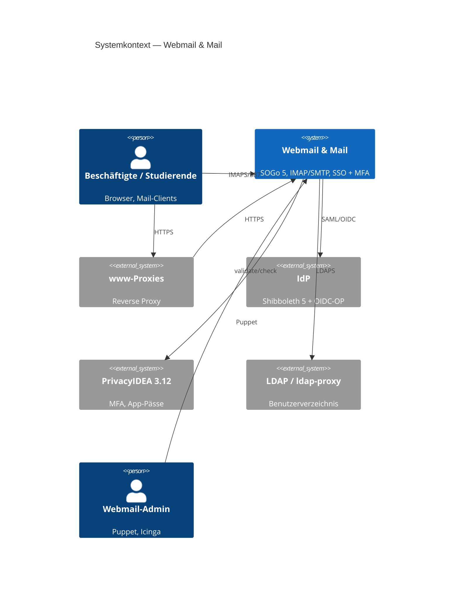

# 3. Kontextabgrenzung

## 3.1 Fachlicher Kontext

*Bewusst nicht im Bild, um es lesbar zu halten:* Föderation (DFN-AAI)
hängt am IdP, die TLS-PKI liefert Zertifikate. Beides steht in der Tabelle unten.
Vhosts und LDAP-/Mail-Endpunkte.

## 3.2 Technischer Kontext

| Nachbar | Protokoll / Schnittstelle | Zweck | Status |
|---|---|---|---|
| IdP (SAML) | SAML 2.0 WebSSO, `/Shibboleth.sso/*` | Webmail-Login per SSO, `REMOTE_USER` an SOGo (`SOGoTrustProxyAuthentication`) | ❌ verworfen — Branch `feature/shibSSO` entfernt, es gilt nur OIDC |
| IdP (OIDC) | OIDC Authorization Code + PKCE, `.well-known/openid-configuration` | SOGo `SOGoAuthenticationType=openid`, Token für IMAP (`XOAUTH2`) | 🟡 Skeleton inert, Client-Registrierung ⛔ |
| PrivacyIDEA | `/validate/check` (durch ldap-proxy), Portal für App-Pässe | 2FA für Mail-Clients, App-Pass `service_id=mailserver` | 🔵 geplant |
| PrivacyIDEA-LDAP-Proxy | LDAPS 1636 (Dovecot→Proxy), LDAPS 636 (Proxy→LDAP) | Bind-Interception, Auth gegen PI, Suchen gegen LDAP | 🔵 geplant |
| central ldap-proxy | LDAPS / LDAP-Binds | Benutzer-Attribute und Auth-Backend; Rate-Limiter + 30 s Idle-Close beachten | ✅ produktiv |
| Dovecot / Postfix | IMAPS 993, Sieve 4190, Submission 587 | Postfach, Filter, Versand | ✅ produktiv |
| SOGo-Datenbank | PostgreSQL/MySQL-URLs (`SOGoProfileURL`, …) | Profile, Ordner-Info, Sessions | ✅ produktiv |
| memcached | 11211 (lokal je Webmail-Knoten, geteilt auf mail-node-04) | Session-/Objekt-Cache, Voraussetzung für Zweitinstanz-Betrieb | ✅ produktiv |
| www-Proxies | HTTPS | Externer Eingang, leitet `/SOGo` an Webmail-Knoten | ✅ produktiv |
| Icinga/NRPE | NRPE, Event-Handler `restart_sogo` | Verfügbarkeitsüberwachung, Crash-Restart | ✅ produktiv |

## 3.3 Abgrenzung

Nicht Teil dieses Systems: zentrale Passwort-/Accountverwaltung (IdP bzw.
Self-Service), Mailstore/Backup der Dovecot-Backends, CALDAV/CardDAV-Clients
außerhalb SOGo, Betrieb der Föderation selbst.
