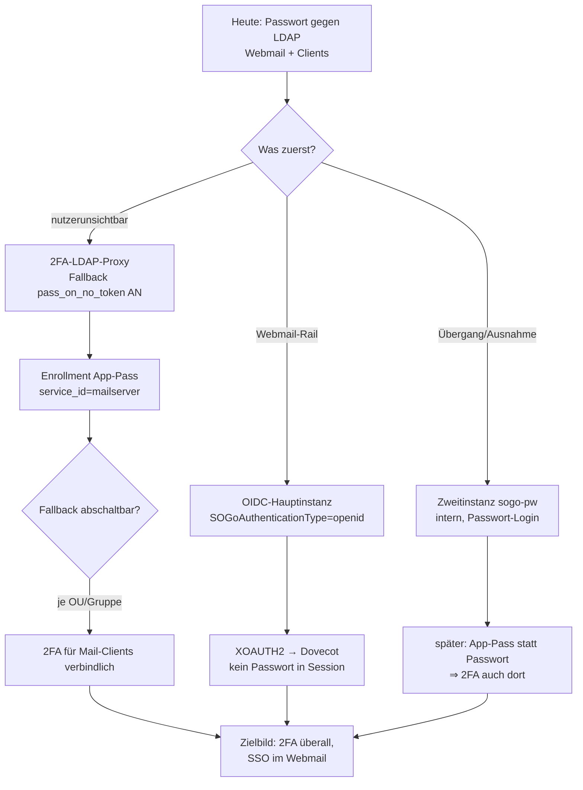

# 4. Lösungsstrategie

## 4.1 Die fünf Pfeiler

**P1 — Portierung statt Copy-Paste.** Die im PoC (`SOGo5-Shib-PoC`, k8s)
erprobten OIDC-Konfigurationen werden als Puppet-Klassen in `profile_sogo` neu
gebaut (`pw_instance.pp`, `eas_server.pp`) mit Parametern und Hiera-Anbindung.
Kein Freitext-Konfigfile, keine Handeingriffe.

**P2 — Zwei Türen, ein Postfach.** Statt pro Nutzer einen Login-Weg zu wählen
(kann SOGo nicht: `SOGoAuthenticationType` ist instanzglobal), gibt es zwei
Instanzen auf demselben Knoten, die dieselbe SOGo-Datenbank und denselben
memcached nutzen. Unterschiedliche Hostnamen ⇒ getrennte Cookies, kein
Session-Konflikt.

**P3 — 2FA über den LDAP-Proxy mit Fallback-Schraube.** Dovecot authentifiziert
nicht mehr direkt gegen LDAP, sondern gegen den PrivacyIDEA-LDAP-Proxy. Der
Fallback (`pass_on_no_token`) hält Nutzer ohne Token im alten Verhalten; Token
greifen automatisch. Damit ist die Einführung nutzerunsichtbar und schrittweise
schärfbar.

**P4 — Reihenfolge nach Risiko, nicht nach Wunsch.** Zuerst was niemanden
bricht (2FA-Fallback für Clients), dann was Nutzer betrifft (Enrollment), dann
der Webmail-Umbau (OIDC), weil dort die Abhängigkeit zur IMAP-Authentifizierung
am größten ist.

**P5 — Alles rückrollbar.** Jede Stufe hat einen definierten Rückweg: eine
Hiera-Zeile, ein `ensure => absent`, ein passdb-Eintrag, ein Branch-Revert.

## 4.2 Warum dieser Weg (und nicht der naheliegende)

| Naheliegend | Problem | Gewählter Weg |
|---|---|---|
| SAML-SP aktivieren, fertig | Proxy-Auth liefert **kein IMAP-Passwort**; SSO-Nutzer können kein Mail abrufen | OIDC (`XOAUTH2`) als Ziel, SAML nur Referenz/Pilot |
| Pro Nutzer SSO optional | SOGo-Auth-Typ ist instanzglobal | Zweitinstanz mit eigenem Auth-Typ |
| Passwort + OTP überall | Clients cachen Passwörter; SOGo hält das Passwort in der Session ⇒ Reconnect nach TOTP-Ablauf scheitert | App-Specific-Password mit `service_id` |
| PI entscheidet, welcher Dienst anfragt | PI sieht nur den Bind | Trennung im Dovecot (Quell-IP/`allow_nets`) ⇒ zwei service_ids |
| Knoten-Firewall für „nur Uni-Netz" | Prod-Traffic kommt über die www-Proxies | Netz-/Perimeter-Team + DNS |

## 4.3 Architektur in einem Satz

Der Mail-Stack behält LDAP als Datenquelle, bekommt aber **eine austauschbare
Authentifizierungs-Schicht** (Proxy oder SOGo-Auth-Typ), die pro Dienst und
schrittweise umschaltbar ist — SSO im Browser, 2FA in den Clients, Passwort als
Rückfall bis zum Stichtag.
