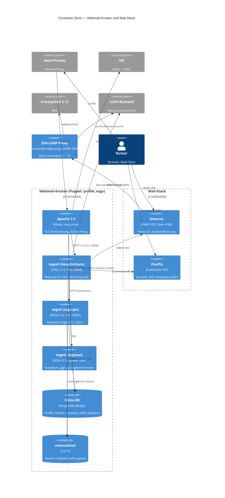
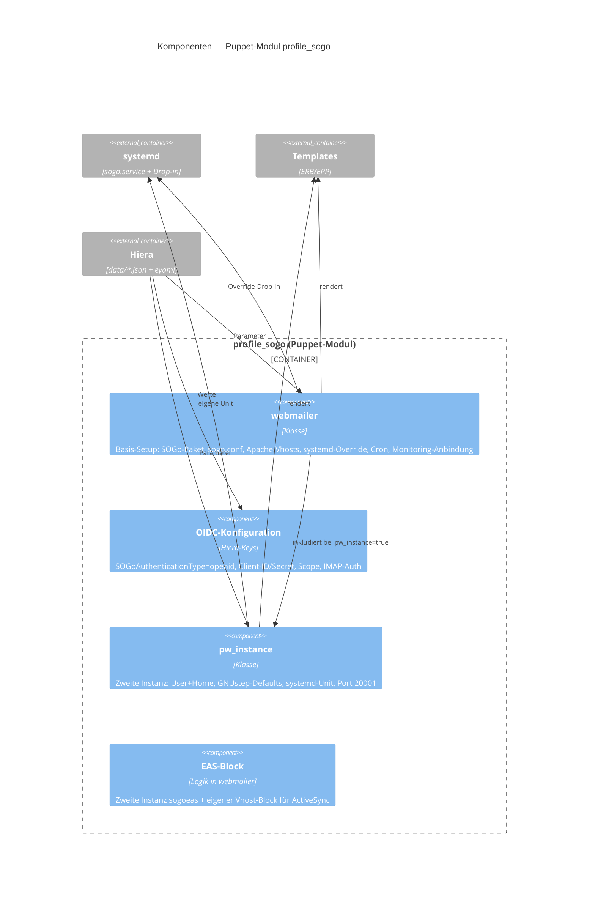

# 5. Bausteinsicht

## 5.1 Ebene 1 — Container

## 5.2 Ebene 2 — Komponenten in `profile_sogo`

## 5.3 Baustein-Verantwortlichkeiten

| Baustein | Datei | Verantwortung |
|---|---|---|
| `profile_sogo::webmailer` | `manifests/webmailer.pp` | SOGo-Paket, `sogo.conf` via `sogo::config`, Apache inkl. Module/Vhosts, systemd-Override, Cronjobs, Footer-Sieve, Branding, EAS- und PW-Vhost-Zweige |
| `profile_sogo::pw_instance` | `manifests/pw_instance.pp` | Isolierte Zweitinstanz: `sogo-pw` + Home, `sogod-pw.plist` (WOPort + Auth-Revert), `/etc/default/sogo-pw`, `sogo-pw.service` |
| `profile_sogo::eas_server` | `manifests/eas_server.pp` | ActiveSync-Zweitinstanz `sogoeas`, eigener Vhost-Block |
| `SOGo.conf.erb` | `templates/SOGo.conf.erb` | Serverweite Proxy-Regeln (`/SOGo` → 20000), Header für `x-webobjects-*`, DAV-Redirects |
| `sogo-pw-vhost.epp` | `templates/sogo-pw-vhost.epp` | `<Location>`-ProxyPass auf 20001, eigener `<Proxy>`-Header-Block ohne `remote-user` |
| `systemd-sogo-override.conf.epp` | `templates/` | Type=forking, Restart=always, RuntimeDirectory, KillMode=control-group |
| `sogod-pw.plist.epp` | `templates/` | WOPort 20001 + Revert der OIDC-/xoauth2-Keys für die PW-Tür |

## 5.4 Bewusste Nicht-Bausteine

- **Kein zweites SOGo-Datenbankschema** je Instanz (wäre ein zweites Postfach).
- **Keine eigene Auth-Middleware** im Webmail — Authentifizierung bleibt bei
  SOGo (OIDC/Passwort) bzw. Dovecot/PI (Mail).
- **Kein SAML-Logout-Integration** (offener Punkt, siehe Kap. 11).
