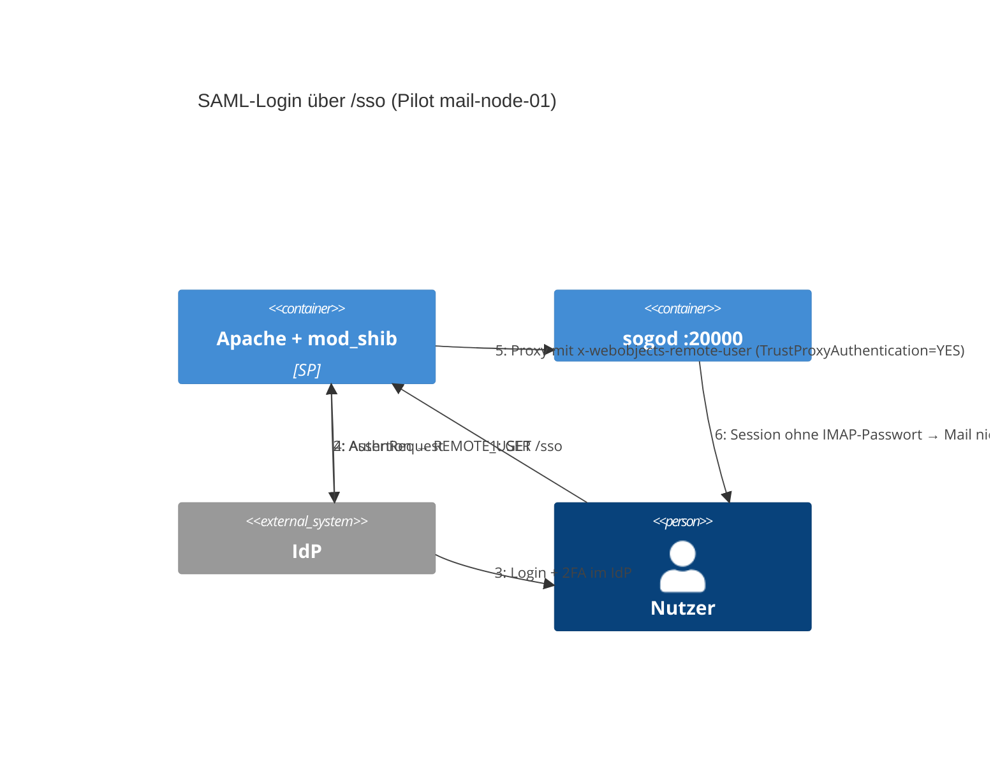
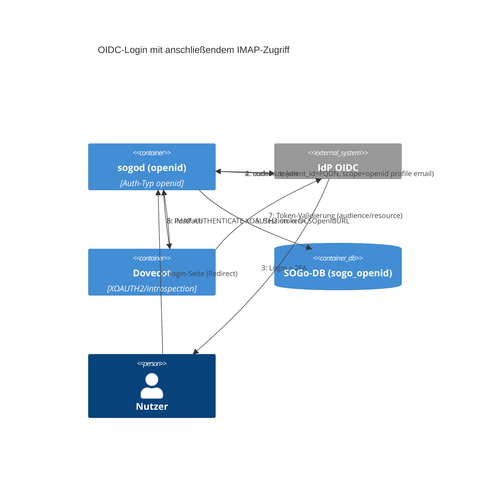
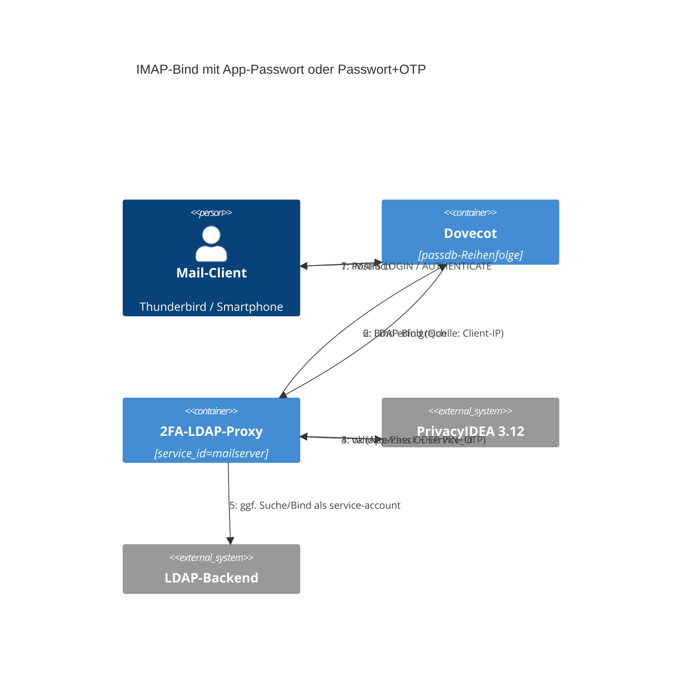
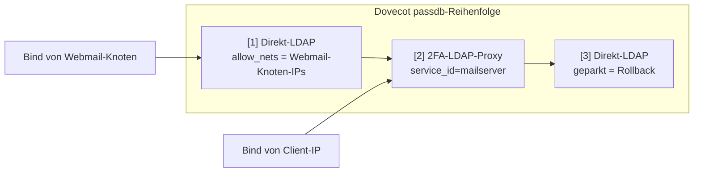
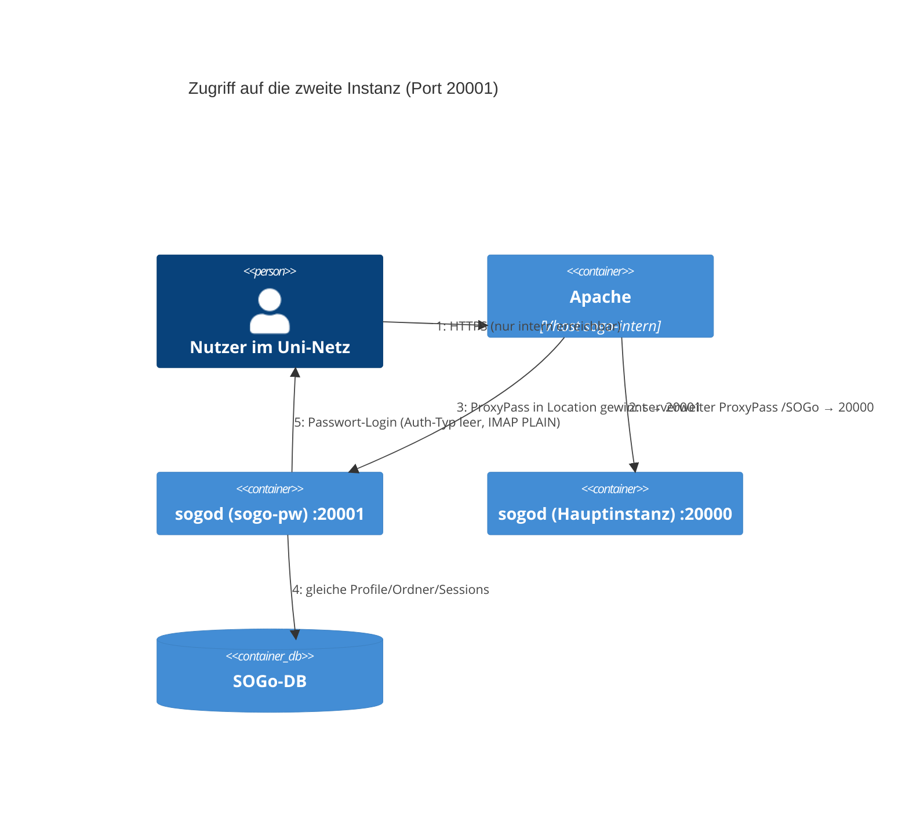

# 6. Laufzeitsicht

## 6.1 Login-Wege im Überblick

| # | Weg | Status | Authentifizierung | IMAP/SMTP danach |
|---|---|---|---|---|
| L1 | Passwort gegen LDAP (heute) | ✅ | LDAP-Bind | Passwort aus Session |
| L2 | SAML-SSO (`/sso`) | ❌ entfernt | Shibboleth-SP, `REMOTE_USER` (Branch `feature/shibSSO` gelöscht) | ❌ kein Passwort ⇒ Postfach bricht |
| L3 | OIDC (Ziel) | 🟡 Skeleton | IdP OIDC, SOGo `openid` | `XOAUTH2` mit Token |
| L4 | Mail-Client mit App-Pass | 🔵 geplant | LDAP-Proxy → PI, `service_id=mailserver` | App-Passwort |
| L5 | Mail-Client mit Passwort+OTP | 🔵 geplant | LDAP-Proxy → PI, `service_id=mailserver` | nur mit aktuellem OTP |
| L6 | Interne Passwort-Tür (`sogo-pw`) | ✅ Code, `pw_instance=true` auf Pilot | LDAP (Revert der OIDC-Keys) | Passwort aus Session |

## 6.2 L2 — SAML-SSO (historisch, Code entfernt)

> Der SAML-Pilot existierte nur auf dem inzwischen gelöschten Branch
> `feature/shibSSO` und ist nicht Teil von `feature/oidcSSO`. Der folgende
> Ablauf ist als Architektur-Hintergrund festgehalten, nicht als Ist-Zustand.

**Kernbefund:** Der Weg beweist die SP-Anbindung, löst aber das IMAP-Problem
nicht. Deshalb ❌ als Endlösung; der Pilot-Code wurde mit dem Branch gelöscht
und wird nicht weitergeführt.

## 6.3 L3 — OIDC (Zielbild Webmail)

**Kritische Punkte** (aus den Referenz-Threads verifiziert):
- Der IdP muss ein **audience-restriktives** Access-Token ausstellen, sonst
  scheitert Dovecot. Weg: Client sendet RFC-8707-`resource` beim **authorize**
  (nicht am Token-Endpoint); IdP-seitig `OAUTH2.TokenAudience`.
- `SOGoXSRFValidationEnabled=NO` wird bei SOGo 5.12.x mit OpenID berichtet —
  erst beim Flip ändern, dann testen.
- `OCSOpenIdURL` (eigene Tabelle/DB) ist Pflicht, sonst keine OpenID-Sessions.

## 6.4 L4/L5 — Mail-Clients über den 2FA-LDAP-Proxy

**Quellrouting** — entscheidend für die Trennung Webmail ↔ Client:

## 6.5 L6 — Interne Passwort-Tür (`sogo-pw`)

**Verifikation nach dem ersten `puppet agent -t`:**
`curl http://127.0.0.1:20001/SOGo` muss das **Passwort-Formular** zeigen, obwohl
die Hauptinstanz ggf. auf `openid` steht — das beweist den GNUstep-Defaults-
Vorrang gegenüber `sogo.conf`.

## 6.6 Fehlerfälle

| Fall | Verhalten |
|---|---|
| `sogod`-Worker stirbt | `Restart=always` + Icinga-Event-Handler `restart_sogo` |
| `/run/sogo` fehlt nach Reboot | `RuntimeDirectory=` legt es beim Unit-Start an (Kaltstart-Fix) |
| OTP abgelaufen bei SOGo-Session | IMAP-Reconnect scheitert → OTP für `service_id=webmail` blockieren (ADR-010) |
| PI nicht erreichbar | Binds scheitern ⇒ Mail-Logins scheitern. Fallback/HA und Monitoring nötig (⛔ offen) |
| IdP nicht erreichbar | OIDC-Login unmöglich; Passwort-Tür als Notfallzugang (nur intern) |
