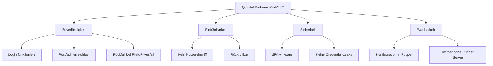

# 10. Qualitätsanforderungen

## 10.1 Qualitätsbaum

## 10.2 Szenarien mit Messkriterien

| ID | Szenario | Kriterium | Status |
|---|---|---|---|
| QS-1 | Nutzer mit gespeichertem Client-Passwort loggt nach 2FA-Rollout ein | Login erfolgreich **ohne** Client-Änderung (Fallback aktiv) | 🔵 geplant |
| QS-2 | Webmail-Session älter als OTP-Fenster, IMAP-Reconnect | Kein Fehler — erreichbar nur, wenn OTP für Webmail gesperrt oder OIDC aktiv | ⚠️ heute verletzt (ADR-010) |
| QS-3 | Rücknahme einer Stufe | ≤ 15 min, ohne Datenmigration | 🔵 Design erfüllt, nicht geübt |
| QS-4 | Pilotknoten nach `puppet agent -t` | `curl :20001/SOGo` zeigt Passwort-Formular | ⛔ nicht getestet |
| QS-5 | Login-Latenz bei Spitze (Semesterstart) | Kein messbarer Anstieg > 200 ms gegenüber Direkt-LDAP | ⛔ PI-Last unbekannt |
| QS-6 | PI nicht erreichbar | Mail-Login scheitert kontrolliert; Alarmierung < 5 min | 🔵 Monitoring fehlt |
| QS-7 | Löschung eines Nutzers | Kein Zugriff mehr über beide Türen | ✅ DB-/LDAP-basiert |
| QS-8 | Zweiter Faktor umgehbar? | App-Pass nur für `service_id=mailserver`, Webmail-Pfad policy-seitig ausgeschlossen | 🔵 geplant |
| QS-9 | Konfigurationsdrift | Kein handgeänderter Zustand auf Prod-Knoten; Puppet-Läufe idempotent | ✅ Muster |
| QS-10 | Neuer Login-Weg | Aufwand ≤ 1 Klasse + Hiera, ohne `SOGo.conf`-Duplikat | ✅ ADR-009 |

## 10.3 Bewertung der Ziele aus Kap. 1

| Ziel | Bewertung heute | Hebel |
|---|---|---|
| 1 Kein Mail-Bruch | **gefährdet**, solange SAML-only gedacht wird | OIDC (L3) bzw. Fallback (ADR-007) |
| 2 Reibungsfreie Einführung | erreichbar | Fallback + App-Pass-Selbstbedienung |
| 3 Rückrollbarkeit | erfüllt im Design | Tests fehlen (QS-3) |
| 4 Nachvollziehbarkeit | erfüllt | Branches, MR, diese Doku |
| 5 Sicherheit ohne Sackgasse | teilweise | ADR-010, App-Pässe statt OTP-Zwang |
| 6 Wartbarkeit | erfüllt | Instanz-Muster, Templates |
